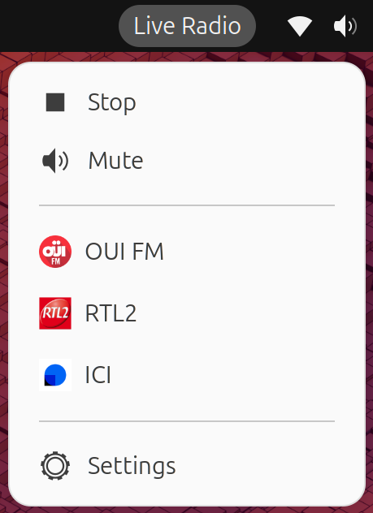

# gnome-shell-extension-liveradio

Listen to live radio stations directly from the GNOME Shell panel



## Features

- Manage your favorite internet radio streams directly from GNOME Shell
- JSON configuration for easy editing of radio lists
- Support for radio icons
- Lightweight and easy to use
- Stop/Mute buttons
- Scroll volume control

## Compatibility

| GNOME Shell Version | Supported |
|---------------------|-----------|
| 48                  | ✅        |
| 49                  | ✅        |
| 50                  | ✅        |
| 51                  | ✅        |

## Installation


## Requirements

- GNOME Shell 48 or later
- GStreamer plugins for audio playback:
  ```bash
  sudo apt install gstreamer1.0-plugins-good gstreamer1.0-plugins-bad gstreamer1.0-plugins-ugly
  ```

### From source

1. **Clone the repository:**
   ```bash
   git clone https://github.com/dmachard/gnome-shell-extension-liveradio.git
   cd gnome-shell-extension-liveradio
   ```

2. **Install to your extensions directory:**
   ```bash
   chmod +x install.sh
   ./install.sh
   ```

3. **Restart GNOME Shell:**
   - On **X11**: Press `Alt+F2`, type `r`, and press Enter
   - On **Wayland**: Log out and log back in

4. **Enable the extension:**
   ```bash
   gnome-extensions enable liveradio@dmachard.dev
   ```

### Testing without installing (Isolated session)

You can run and test the extension in an isolated nested GNOME Shell window without modifying your current desktop session:

```bash
chmod +x test-nested.sh
./test-nested.sh
```

Close the nested window when you are done.

## Settings

Open the LiveRadio preferences from GNOME Extensions to managing Radio Stations.

Radios are stored in a JSON format

```json
[
  {
    "name": "Radio Paradise",
    "url": "https://stream.radioparadise.com/mp3-192",
    "logo": "https://radioparadise.com/graphics/logo_200.png"
  }
]
```

> Copy the contents of `stations.json.example` from this repository


Each radio can have:
- name → Display name
- url → Stream URL
- logo → Optional icon. It can be a local filename or a full HTTP/HTTPS URL. If empty or invalid, the default icon will be used.

You can add your custom icons in:

```bash
~/.local/share/liveradio/icons/
```

The extension will create `~/.local/share/liveradio/icons/` automatically if it doesn’t exist.

### Export / Import stations

You can export or import your stations list via command line using `dconf`:

- **Export to a file:**
  ```bash
  dconf read /org/gnome/shell/extensions/liveradio/radios | sed "s/^'//;s/'$//" | jq . > stations.json
  ```

- **Import from a file:**
  ```bash
  dconf write /org/gnome/shell/extensions/liveradio/radios "'$(cat stations.json)'"
  ```


## Troubleshooting

View logs in real-time

```bash
$ journalctl -f | grep -i liveradio
Nov 11 10:30:20 denis-laptop gnome-shell[207832]: [LiveRadio] ERROR: Failed to set pipeline to PLAYING state
```

## Build for website

Developers Guide: https://gjs.guide/extensions/

Update the version in `metadata.json`
Zip and upload at  https://extensions.gnome.org/upload/

```bash
cd ~/.local/share/gnome-shell/extensions/liveradio@dmachard.dev

zip -r ~/liveradio@dmachard.dev.shell-extension.zip \
    extension.js \
    prefs.js \
    radioPanel.js \
    radioPlayer.js \
    metadata.json \
    stylesheet.css \
    schemas/org.gnome.shell.extensions.liveradio.gschema.xml
```

Before uploading, you can run the Shexli static analyzer locally to catch common packaging and review issues early.

```bash
virtualenv venv
. venv/bin/activate
pip install -U shexli
shexli path_to_zip_or_folder
```